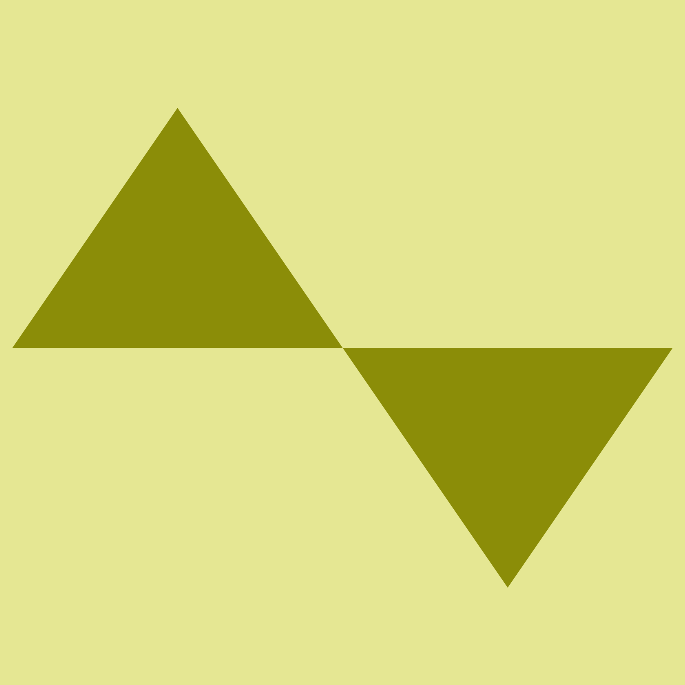
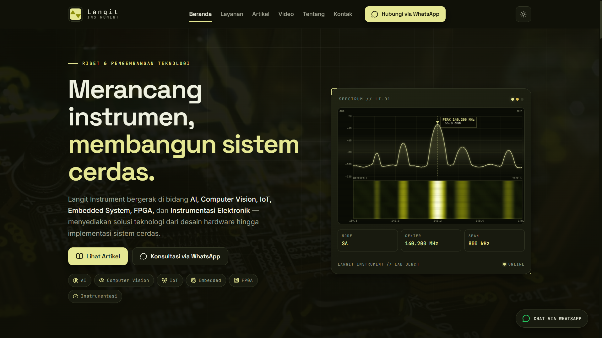

<div align="center">
  
  <h1>Langit Instrument</h1>
  <p><strong>Website riset &amp; pengembangan teknologi — dari desain hardware hingga sistem cerdas.</strong></p>

  <p>
    <a href="https://muhammad-yunus.github.io/langit-instrument-blog/">
      
    </a>
    
    
    
    
    
  </p>

  <p>
    
    
    
    
    
    
  </p>

  
</div>

---

## Tentang

**Langit Instrument** adalah situs profil sekaligus wadah publikasi seputar **AI, Computer Vision, IoT, Embedded System, FPGA,** dan **Instrumentasi Elektronik**. Situs ini menggabungkan portofolio kapabilitas, artikel teknis dari Medium, dan arsip video YouTube dalam satu antarmuka ringan yang bisa di-host secara statis.

Dibangun dengan HTML, CSS, dan JavaScript murni — **tanpa framework dan tanpa build step**. Aset eksternal hanya Google Fonts dan ikon [Lucide](https://lucide.dev) via CDN. Konten artikel disinkronkan dari Medium melalui skrip Node kecil.

## Fitur

- **Spectrum analyzer animasi** — canvas dengan sumbu dBm, span 139.8–140.6 MHz, puncak sinyal di **140.200 MHz**, dan waterfall real-time. Animasi berhenti saat elemen tidak terlihat atau tab tidak aktif, serta menghormati `prefers-reduced-motion`.
- **Blog dari Medium** — 10 artikel terbaru, lengkap dengan cover, kategori, waktu baca, filter kategori, highlight artikel, dan rekomendasi artikel terkait.
- **Galeri video YouTube** — 13 video pilihan, modal accessible dengan embed `youtube-nocookie.com`, focus trap, dan dukungan tombol `Esc`.
- **Tema gelap & terang** — default mengikuti preferensi sistem, tersimpan di `localStorage`, bebas flash saat halaman dimuat.
- **Responsif penuh** — diuji dari 360 px hingga 1440 px; grid menyesuaikan 1/2/3 kolom.
- **Ramah aksesibilitas** — skip link, focus state, `aria-*`, navigasi keyboard, kontras teks yang memadai, dan reduced-motion.
- **SEO & berbagi** — meta description, Open Graph, Twitter Card, JSON-LD Organization, serta tombol berbagi WhatsApp, Facebook, dan salin tautan.
- **Tanpa backend** — seluruh konten berupa file statis; data artikel dan video dibaca dari JavaScript global sehingga tetap berfungsi saat dibuka via `file://`.

## Tech Stack

| Lapisan | Teknologi |
| --- | --- |
| Markup | HTML5 semantik |
| Styling | CSS modern (custom properties, grid, clamp, `color-mix`) |
| Interaksi | JavaScript vanilla (IIFE, tanpa dependensi) |
| Visual | Canvas 2D, SVG (ikon Lucide) |
| Font | Space Grotesk, Inter, JetBrains Mono |
| Data | Medium RSS → `assets/data/articles.js` |
| Hosting | GitHub Pages (branch `main`, root) |

## Tools

| Tool | Kegunaan |
| --- | --- |
| Node.js ≥ 18 | Menjalankan `tools/sync-medium.mjs` untuk memperbarui artikel |
| Python 3 atau `npx serve` | Server lokal untuk pengembangan |
| Git + GitHub CLI (opsional) | Versioning dan deploy |
| Chrome DevTools | QA responsif, tema, dan performa canvas |

## Struktur Proyek

```text
.
├── .nojekyll                 # Menonaktifkan pemrosesan Jekyll di GitHub Pages
├── index.html                # Halaman utama: hero, layanan, artikel, video, tentang, kontak
├── article.html              # Template detail artikel (?slug=...)
├── docs/
│   └── blog_screenshoot.png  # Screenshot pratinjau untuk README
├── assets/
│   ├── css/
│   │   ├── theme.css         # Design tokens, palet gelap/terang, reset, utilitas
│   │   └── main.css          # Komponen, layout, animasi, dan breakpoint responsif
│   ├── data/
│   │   ├── articles.js       # Hasil sinkronisasi Medium (window.LANGIT_ARTICLES)
│   │   └── videos.js         # Daftar video kurasi (window.LANGIT_VIDEOS)
│   ├── img/
│   │   ├── banner.png        # Gambar OG/sosial
│   │   ├── bg.jpg            # Tekstur latar hero
│   │   ├── logo_compact.png
│   │   └── logo_square.png
│   └── js/
│       ├── theme.js          # Toggle tema, persistensi, sinkronisasi meta
│       ├── ui.js             # Navigasi, reveal, back-to-top, helper UI
│       ├── home.js           # Highlight, filter artikel, grid video, modal
│       ├── article.js        # Render artikel, share, related, progress baca
│       └── spectrum.js       # Spectrum analyzer + waterfall berbasis canvas
└── tools/
    └── sync-medium.mjs       # Generator data artikel dari RSS Medium
```

## Menjalankan Lokal

```bash
git clone https://github.com/Muhammad-Yunus/langit-instrument-blog.git
cd langit-instrument-blog

# Opsi 1 — Python
python -m http.server 8000

# Opsi 2 — Node
npx serve .
```

Buka `http://localhost:8000`. Halaman juga dapat dibuka langsung via `file://`, tetapi server lokal lebih disarankan agar perilaku sama dengan produksi.

## Memperbarui Konten

### Artikel Medium

```bash
node tools/sync-medium.mjs
```

Skrip mengambil RSS `https://medium.com/feed/@yunusmuhammad007`, membersihkan konten, lalu menulis ulang `assets/data/articles.js`. Commit perubahan file tersebut untuk memperbarui situs.

### Video YouTube

Edit `assets/data/videos.js`, tambahkan objek berisi `id` dan `title`:

```js
{ id: "VIDEO_ID", title: "Judul video" }
```

## Kustomisasi

### Warna & Tema

Semua token desain berada di `assets/css/theme.css`:

```css
:root {
  --primary: #e5e793;
  --secondary: #8b8d08;
  --bg: #101108;
  --text: #eef0e0;
  --muted: #9fa191;
}
```

Palet terang di-override lewat `[data-theme="light"]`. Tema default mengikuti `prefers-color-scheme` dan dapat diganti lewat tombol di header.

### Spectrum Analyzer

Parameter simulasi berada di bagian atas `assets/js/spectrum.js`:

| Konstanta | Nilai | Keterangan |
| --- | --- | --- |
| `FREQ_MIN` / `FREQ_MAX` | `139.8` / `140.6` | Rentang frekuensi (MHz) |
| `DB_TOP` / `DB_BOTTOM` | `-20` / `-120` | Rentang sumbu vertikal (dBm) |
| `BINS` | `261` | Resolusi trace; titik tengah tepat di 140.200 MHz |
| `WF_ROWS` | `96` | Jumlah baris waterfall |
| `signals` | `center`, `power`, `width` | Definisikan puncak sinyal dan lebar Gaussian-nya |

## Deployment

Situs di-deploy otomatis ke GitHub Pages setiap kali ada push ke `main`:

1. **Settings → Pages → Build and deployment**
2. Source: **Deploy from a branch**
3. Branch: `main`, folder: `/ (root)`
4. File `.nojekyll` memastikan seluruh aset statis disajikan apa adanya.

**Live:** https://muhammad-yunus.github.io/langit-instrument-blog/

## Kontak

| Kanal | Tautan |
| --- | --- |
| WhatsApp | [+62 813-3832-7438](https://wa.me/6281338327438) |
| Facebook | [facebook.com/langitinstrument](https://www.facebook.com/langitinstrument/) |
| Medium | [@yunusmuhammad007](https://medium.com/@yunusmuhammad007) |
| YouTube | [Langit Instrument](https://www.youtube.com/channel/UC5-3Ue-dDU3TV0m1MQJ0EOA) |

## Kredit

- Ikon oleh [Lucide](https://lucide.dev).
- Font oleh [Google Fonts](https://fonts.google.com): Space Grotesk, Inter, JetBrains Mono.
- Artikel dan video milik penulis di Medium dan YouTube masing-masing.
